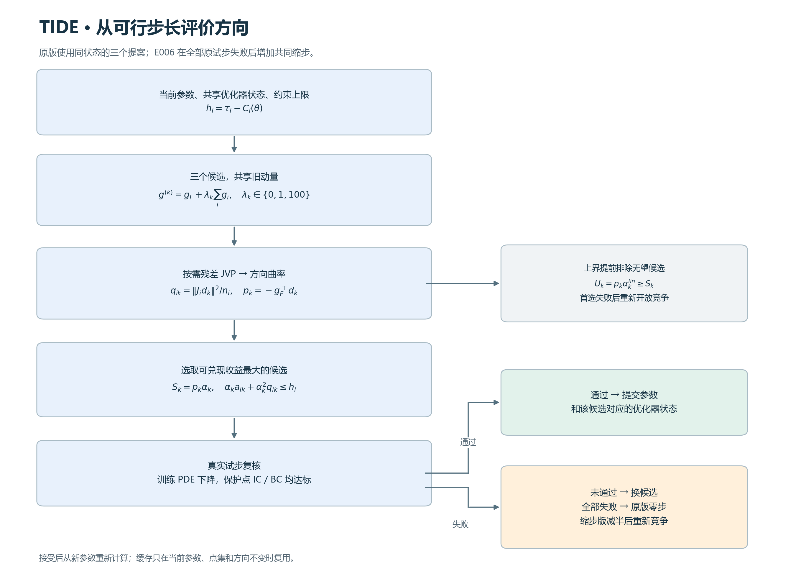
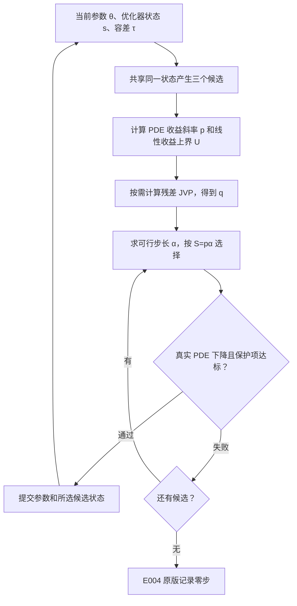
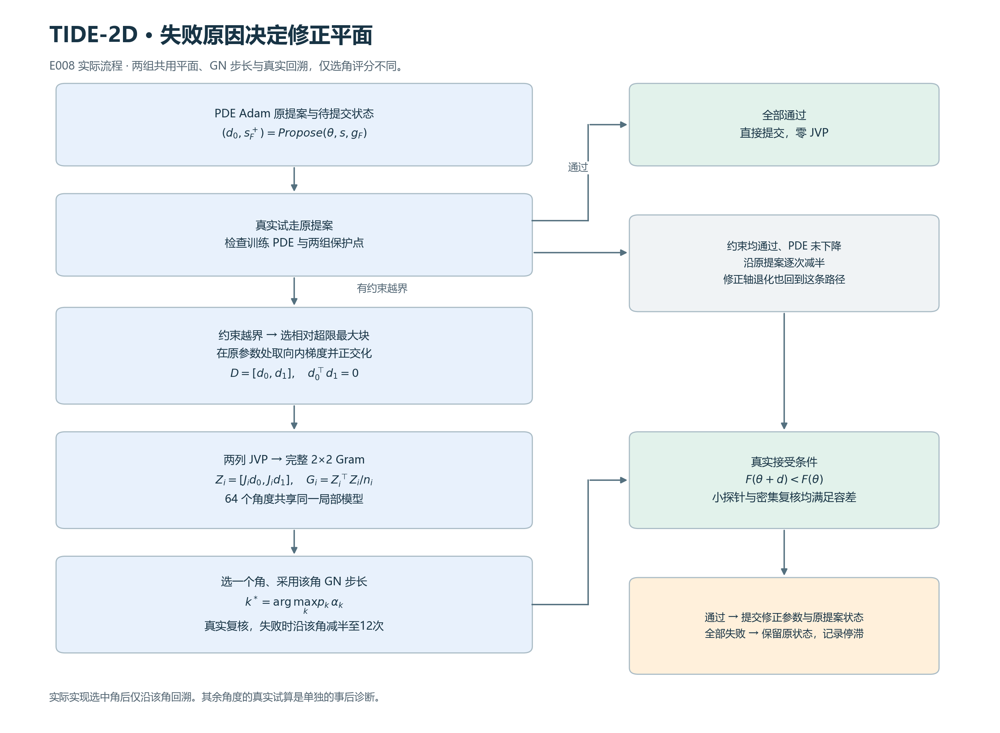
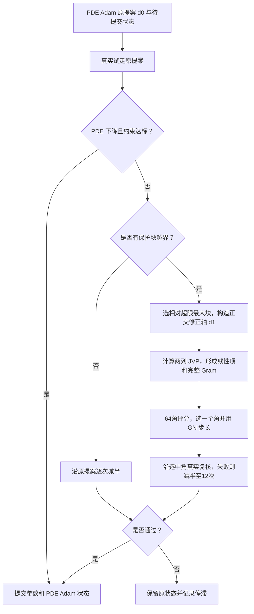
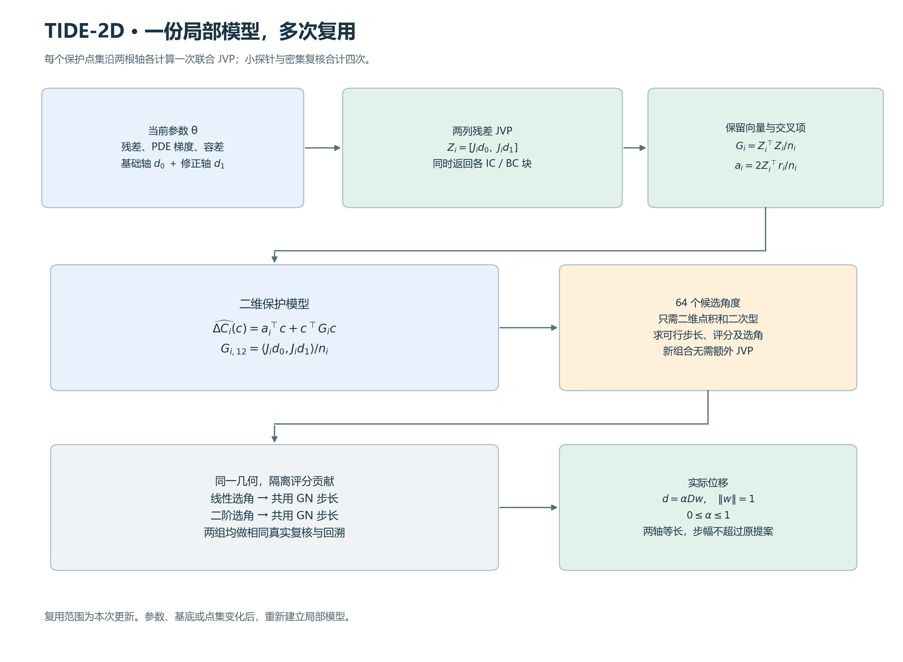

# TIDE 算法图解与公式

本说明依据 E004、E006 和 E008 的实际实现，供导师汇报使用。原版指 E004 的有效步长评分版；缩步版对应 E006；TIDE-2D 对应 E008。早期 E003 使用过按 PDE 斜率排序的变体。

## 1. 统一的问题定义

参数为 $\theta$，优化器状态为 $s$。$F(\theta)$ 是训练 PDE 残差损失，$C_i(\theta)$ 是某一组保护点上的 IC 或 BC 损失，$\tau_i>0$ 是其上限。

$$
F(\theta)=\frac{\|r_F(\theta)\|^2}{n_F},
\qquad
C_i(\theta)=\frac{\|r_i(\theta)\|^2}{n_i},
\qquad
h_i=\tau_i-C_i(\theta).
$$

每一步从可行状态出发，寻找一个位移 $d$，使 PDE 损失下降，同时保护项仍满足上限。

$$
\min_d F(\theta+d),
\qquad C_i(\theta+d)\le\tau_i.
$$

IC 和 BC 可以在一步中上升，消耗剩余裕量 $h_i$。上限由实验精度设定，实验采用 $\max(10^{-4},2C_i(\theta_0))$；各版本具体启动集见冻结协议。验证集和最终审计集只用于评价。E006 与 E008 同时在小探针和密集复核集检查 IC、BC。

## 2. 原版 TIDE

### 2.1 从同一状态生成候选

$$
g_F=\nabla F(\theta),\qquad g_i=\nabla C_i(\theta),
\qquad
g^{(k)}=g_F+\lambda_k\sum_i g_i,
\qquad \lambda_k\in\{0,1,100\}.
$$

基础优化器试算

$$
(d_k,s_k^+)=\operatorname{Propose}(\theta,s,g^{(k)}).
$$

Adam 情形，每个候选都使用相同旧 $m,v,t$。

$$
m_k^+=\beta_1m+(1-\beta_1)g^{(k)},\quad
v_k^+=\beta_2v+(1-\beta_2)(g^{(k)})^2,
\quad
d_k=-\eta\frac{m_k^+/(1-\beta_1^{t+1})}
{\sqrt{v_k^+/(1-\beta_2^{t+1})}+\epsilon}.
$$

运算逐元素进行。候选试算后暂存对应状态，仅在选中并接受时提交。原实验 $\eta=10^{-3}$、$\beta_1=0.9$、$\beta_2=0.999$。

### 2.2 用残差 JVP 建模

$$
p_k=-g_F^\top d_k,\quad
a_{ik}=g_i^\top d_k,\quad
z_{ik}=J_{r_i}(\theta)d_k,\quad
q_{ik}=\frac{\|z_{ik}\|^2}{n_i}\ge0.
$$

对残差线性化后平方，得到保护块模型

$$
\widehat C_i(\theta+\alpha d_k)
=C_i(\theta)+\alpha a_{ik}+\alpha^2q_{ik}.
$$

$q$ 是方向 Gauss–Newton 曲率。完整损失 Hessian 还含有残差乘以残差 Hessian 的项，真实有限步长变化仍需复核。代码已将残差除以 $\sqrt{n_i}$，故计算中以平方和表示 MSE。

### 2.3 联合评价方向与步长

$$
\alpha_k=\max\{\alpha\in[0,1]:
\alpha a_{ik}+\alpha^2q_{ik}\le h_i,\ \forall i\},
\qquad S_k=p_k\alpha_k.
$$

仅保留 $p_k>0$ 的候选。对 $h_i\ge0,q_{ik}>0$，每块允许步长是

$$
\alpha_{ik}
=\min\!\left(1,
\frac{-a_{ik}+\sqrt{a_{ik}^2+4q_{ik}h_i}}{2q_{ik}}
\right),\qquad
\alpha_k=\min_i\alpha_{ik}.
$$

当 $a\ge0$ 时实现使用等价的稳定根式 $2h/(\sqrt{a^2+4qh}+a)$。$q=0,a>0$ 时为 $\min(1,h/a)$，$q=0,a\le0$ 时为1。$h=q=a=0$ 按后一规则取1。$h=0,q>0,a\ge0$ 时只能取0。起点越界另列，不能直接作为可行启动。

### 2.4 按需计算

去掉非负二次项，得到线性模型允许的步长和收益上界

$$
\alpha_k^{\rm lin}
=\max\{\alpha\in[0,1]:\alpha a_{ik}\le h_i,\forall i\},
\qquad
U_k=p_k\alpha_k^{\rm lin}\ge S_k.
$$

按 $U_k$ 从大到小查询 JVP。若剩余候选上界严格低于当前最高真实模型分数，则结束查询。平局用固定候选编号，并对浮点近似平局保守扩展。首选真实复核失败时删除它，重新在剩余候选中选择；先前因上界被跳过的候选仍可重新进入竞争。

### 2.5 提交与缩步改进

真实接受条件为

$$
F(\theta+\alpha_kd_k)<F(\theta),
\qquad
C_i^{\rm small}(\theta+\alpha_kd_k)\le\tau_i,
\qquad
C_i^{\rm review}(\theta+\alpha_kd_k)\le\tau_i.
$$

E004 只有原保护点，E006 增加密集复核。E006 的缩步版先以倍率1检查所有候选，全部失败后在倍率 $1/2$ 下重新竞争全部候选，依次至 $1/4096$。每轮都复用同一次参数位置的曲率。接受后更新

$$
\theta^+=\theta+2^{-\ell}\alpha_kd_k,\quad s^+=s_k^+.
$$

所有倍率均失败时，参数和优化器状态保留原值，固定确定性训练记录停滞。曲率缓存仅对当前参数、方向和点集有效。

## 3. TIDE-2D

实际 E008 选中一个角后，只沿该角回溯；没有在同一步继续试其他角。修正轴退化时沿原提案回溯。

### 3.1 由失败原因构造二维平面

原提案使用 PDE 梯度

$$
(d_0,s_F^+)=\operatorname{Propose}(\theta,s,g_F).
$$

在试步越界的保护块中选相对超限最大者

$$
j=\arg\max_i\left(\frac{C_i(\theta+d_0)}{\tau_i}-1\right).
$$

下标 $i$ 同时遍历小探针与密集复核集各自的 IC、BC。在原参数位置取得向内负梯度

$$
v=-\nabla C_j(\theta),\qquad
u=\frac{d_0}{\|d_0\|},\qquad
v_\perp=v-u(u^\top v),
$$

$$
d_1=\|d_0\|\frac{v_\perp}{\|v_\perp\|},
\qquad D=[d_0,d_1].
$$

当 $d_0=0$ 或修正轴数值退化时回退一维试算。$d_1$ 去掉了与原轴平行的部分，其自身对该块的一阶变化非正；与 $d_0$ 的组合仍需模型和真实复核。

### 3.2 同一份 JVP 支持构造、选择与定步长

$$
Z_i=[J_i d_0,J_i d_1],\qquad
a_i=\frac{2Z_i^\top r_i}{n_i},\qquad
G_i=\frac{Z_i^\top Z_i}{n_i}\succeq0.
$$

任意组合位移 $d=Dc$ 的预测保护变化为

$$
\widehat{\Delta C_i}(c)=a_i^\top c+c^\top G_i c.
$$

$$
G_i=\frac1{n_i}
\begin{bmatrix}
\|J_id_0\|^2 & (J_id_0)^\top(J_id_1)\\
(J_id_1)^\top(J_id_0) & \|J_id_1\|^2
\end{bmatrix}.
$$

交叉项刻画两个轴在同一残差空间内的相互作用。只保留两个平方范数会丢失该信息。固定点、参数、基底下，$J_i(Dc)=Z_ic$ 是精确线性关系。代码在每个点集做两次联合残差 JVP，小探针与密集复核合计四次，每次同时返回 IC 与 BC 分量。

### 3.3 在64个角中联合选方向和步长

$$
w_k=\left(\cos\frac{2\pi k}{64},
\sin\frac{2\pi k}{64}\right)^\top,
\qquad k=0,\ldots,63.
$$

$$
p_k=-g_F^\top Dw_k,
\quad A_{ik}=a_i^\top w_k,
\quad Q_{ik}=w_k^\top G_iw_k,
\quad
\alpha_k=\max\{\alpha\in[0,1]:
\alpha A_{ik}+\alpha^2Q_{ik}\le h_i,\forall i\}.
$$

GN 选角使用 $S_k=p_k\alpha_k$，取最大正收益。线性对照用 $S_k^{\rm lin}=p_k\alpha_k^{\rm lin}$ 选角，选中后同样使用 GN 步长 $\alpha_k$。这隔离了二阶选角的作用。

因为两轴正交且等长，$\|Dw_k\|=\|d_0\|$；$\alpha_k\le1$ 将组合步长控制在原提案尺度内。单次 JVP 结果可以评价所有角度。

### 3.4 真正更新的规则

选中角度 $k^*$ 后，依次测试

$$
\theta_{\rm trial}
=\theta+2^{-\ell}\alpha_{k^*}Dw_{k^*},
\qquad \ell=0,\ldots,12.
$$

首次满足真实接受条件时提交 $\theta^+=\theta_{\rm trial}$，并提交基础 PDE Adam 的 $s_F^+$。该优化器状态由 PDE 梯度产生，二维修正作用于实际位移；没有给角度另算或混合二阶矩。全部失败则保持原状态。

## 4. 版本比较与汇报时的说法

|版本|方向从哪里来|曲率作用|失败后|
|---|---|---|---|
|E004 TIDE|三个加权梯度的优化器提案|预测各候选可行步长，按收益选方向|换候选|
|E006 缩步版|相同三候选|原评分与曲率查询可复用|每次减半后重新竞争候选|
|E008 TIDE-2D|PDE提案＋一个向内正交轴|完整二维GN模型选角与定步长|沿选中角回溯|

汇报顺序可采用“允许反弹的问题定义 → 曲率预测可行收益 → 按需查询 → 缩步修复 → 二维修正和JVP复用 → 在线结果”。方法机制和效果分别展示。

实际结果为 E006 TIDE+缩步 0/24 稳定达标，E008 两组也均为0/24、各24/24停滞。GN选角相对线性选角的终点参考误差为12胜、1平、11负。图示解释实际试验方案，现有实验尚未支持稳定的长期优化优势。

## 5. 实现对应

- 原版与按需查询：[E004 replay.py](../experiments/e004_tide_score_replay/replay.py)。
- 三候选公共缩步：[E006 converge.py](../experiments/e006_convergence/converge.py)。
- 二维分支、选块、Gram与64角：[E008 train.py](../experiments/e008_tide2d/train.py)。
